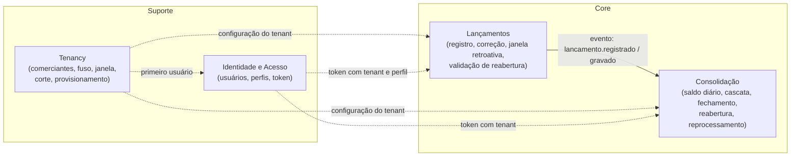

# 01 — Domínios funcionais e capacidades de negócio

## Contexto de negócio

O comerciante (tenant, P1) precisa saber, a cada dia, **quanto entrou, quanto
saiu e com quanto fechou**, para decidir compras, pagamentos e conferir o
caixa. O fluxo de caixa é alimentado por quem opera o caixa (operador) e
conferido por quem responde pelo negócio (gestor). O valor do dia só é
"oficial" depois do fechamento (ADR-0010); antes disso é parcial.

O produto é multi-tenant: a mesma plataforma serve vários comerciantes, com
isolamento de dados e de configuração (fuso, janela retroativa, horário de
corte) por tenant.

## Mapa de capacidades

| Capacidade | Descrição | Tipo | Domínio |
|---|---|---|---|
| Registrar lançamento | Aceitar um crédito ou débito com valor, descrição e data, dentro da janela permitida, e garantir que nenhum aceito se perca | **Core** | Lançamentos |
| Corrigir lançamento | Alterar valor, tipo ou descrição de um lançamento existente, refletindo nos saldos | Core | Lançamentos |
| Consolidar saldo diário | Manter, por dia, saldo inicial, créditos, débitos e saldo final, encadeados dia a dia | **Core** | Consolidação |
| Fechar o dia | No horário de corte do tenant, tornar o saldo do dia o valor oficial | **Core** | Consolidação |
| Reabrir dia fechado | Permitir correção de um dia já fechado, com autorização e rastro | Core | Consolidação |
| Consultar saldo diário | Disponibilizar o saldo de um dia ou de um período, com status aberto/fechado | Core | Consolidação |
| Consultar lançamentos | Listar os lançamentos do tenant | Suporte | Lançamentos |
| Reprocessar saldos | Recalcular a partir de uma data (reparo, auditoria) | Suporte | Consolidação |
| Autenticar usuário | Login com email e senha; emitir token com tenant e perfil | Suporte | Identidade e Acesso |
| Autorizar por perfil | Distinguir operador de gestor (quem pode reabrir dia) | Suporte | Identidade e Acesso |
| Provisionar comerciante | Criar tenant com schema, role, fuso e corte; primeiro usuário | Suporte | Tenancy |
| Configurar comerciante | Alterar fuso e horário de corte | Suporte | Tenancy |
| Monitorar saúde | Health check, status das dependências, métricas por tenant | Genérica | Plataforma |
| Estornar lançamento | Lançamento inverso vinculado ao original | Core (evolução) | Lançamentos |
| Fechar o mês | Bloquear reabertura além do período contábil | Core (evolução) | Consolidação |

Classificação: **core** é o que diferencia o produto e onde a regra de
negócio mora; **suporte** é necessário mas não diferencia; **genérica** é
resolvida por ferramenta de mercado.

## Domínios e bounded contexts

**Por que Consolidação é um context separado de Lançamentos.** Os dois têm
ciclos de vida e regras diferentes: Lançamentos é sobre *fatos* (o que
aconteceu, quando, quanto), imutáveis exceto por correção explícita;
Consolidação é sobre uma *visão derivada* (o saldo por dia), que pode ser
recalculada a qualquer momento a partir dos fatos e que carrega regras
próprias (encadeamento de dias, fechamento, reabertura). Separar os dois é o
que permite o RNF-01 (lançamentos não dependem do consolidado) e o
read model (ADR-0002). No código de hoje são módulos; no alvo, serviços
(ADR-0003).

**O que é "dia".** Um lançamento pertence ao dia em que `criado_em` cai **no
fuso do tenant**. O dia começa à meia-noite e o fechamento acontece no
horário de corte do tenant; um lançamento após o corte, no mesmo dia,
pertence a esse dia e o reabre (ADR-0010). Essa definição é de Tenancy
(configuração) e é aplicada por Lançamentos (validação) e Consolidação
(cálculo).

**Quem é dono de "comerciante".** Tenancy. Lançamentos e Consolidação só
conhecem o `comerciante_id` e a configuração que recebem; não criam nem
alteram tenants.

## Context map

| Upstream | Downstream | Tipo de relação | Contrato |
|---|---|---|---|
| Lançamentos | Consolidação | **Published language** (evento): Lançamentos publica, Consolidação conforma-se ao contrato do evento | `lancamento.registrado` / `lancamento.gravado`: `id`, `comerciante_id`, `tipo_movimento`, `valor`, `criado_em`, `pode_reabrir`, `usuario_id`, `schema_version` |
| Tenancy | Lançamentos, Consolidação | **Conformist**: os cores usam a configuração como está (fuso, `hora_fechamento`) | Catálogo `comerciantes` (hoje: tabela compartilhada com cache; alvo: evento `tenant.atualizado` ou consulta com cache) |
| Identidade e Acesso | Lançamentos, Consolidação | **Conformist**: token JWT com `comerciante_id` e `perfil` | JWT assinado; claims `id`, `email`, `comerciante_id`, `perfil` |
| Tenancy | Identidade e Acesso | **Customer-supplier**: o provisionamento cria o primeiro usuário (gestor) | `POST /admin/tenants` |
| Consolidação | Lançamentos | Sem dependência obrigatória. Lançamentos verifica se o dia está fechado para recusar o operador na hora, com uma mensagem clara; se não conseguir verificar, enfileira do mesmo jeito. Quem decide sobre dia fechado é Consolidação, ao consumir o evento, usando `pode_reabrir`. No alvo, essa verificação passa a ser feita por consulta ao Consolidado ou pelo evento `dia.fechado` | evento `dia.fechado` / `dia.reaberto` (alvo) |

## Linguagem ubíqua

| Termo | Significado |
|---|---|
| Comerciante (tenant) | Cliente da plataforma; dono de um conjunto isolado de lançamentos e saldos, com configuração própria |
| Lançamento | Fato financeiro: crédito ou débito, com valor, descrição e instante |
| Crédito / Débito | Entrada / saída de dinheiro no caixa |
| Dia (contábil) | Data de um lançamento no fuso do comerciante |
| Saldo inicial / final | Saldo com que o dia começa (= final do dia anterior) e termina |
| Consolidação | Recalcular o saldo de um dia e dos seguintes a partir dos lançamentos |
| Cascata | Reconsolidação do dia alterado e de todos os seguintes até hoje |
| Janela retroativa | Quantos dias no passado um lançamento pode ser registrado ou corrigido |
| Fechamento | Corte diário (`hora_fechamento`) após o qual o saldo do dia é o valor oficial |
| Reabertura | Alteração de um dia fechado por lançamento ou correção; exige gestor e fica registrada |
| Operador / Gestor | Perfis: operador registra e consulta; gestor também reabre dias |
| Reprocessar | Recalcular saldos a partir de uma data sem alterar lançamentos nem status |
