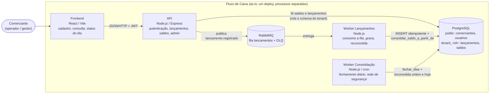
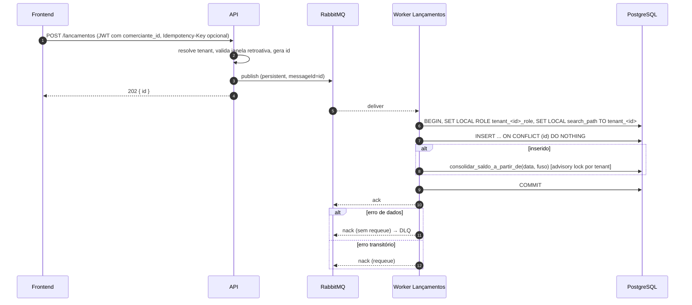
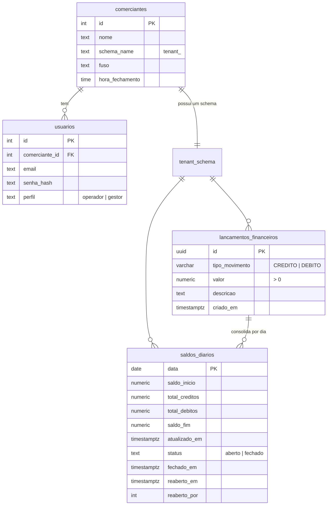

# 03 — Arquitetura atual (as-is)

Descreve o que está implementado neste repositório. Serve de ponto de partida
para a arquitetura alvo (doc 04) e para a transição (doc 05).

## C4 — Nível 2: Containers

## Fluxo de um lançamento

## Modelo de dados

Schema `public`: catálogo. Schema `tenant_<id>`: dados de cada comerciante, acessados pela role `tenant_<id>_role`.

## Limitações conhecidas do as-is

O que o exemplo executável **não** faz e a arquitetura alvo (doc 04) resolve:

- **Um único deploy** para API, consolidado e workers: a fronteira entre os
  dois serviços é de módulo, não de deploy (ADR-0003).
- **Um único banco** para lançamentos e read model, com gravação e
  consolidação na mesma transação; no alvo são dois eventos (doc 04).
- **Sem gateway:** TLS, rate limit por tenant e WAF não existem localmente
  (doc 06).
- **Sem cache** no consolidado, por decisão (ADR-0002).
- **Requeue com pausa fixa**, sem backoff nem limite de tentativas (ADR-0007).
- **Observabilidade mínima:** `/health`, `/status` e logs em texto (doc 07).
