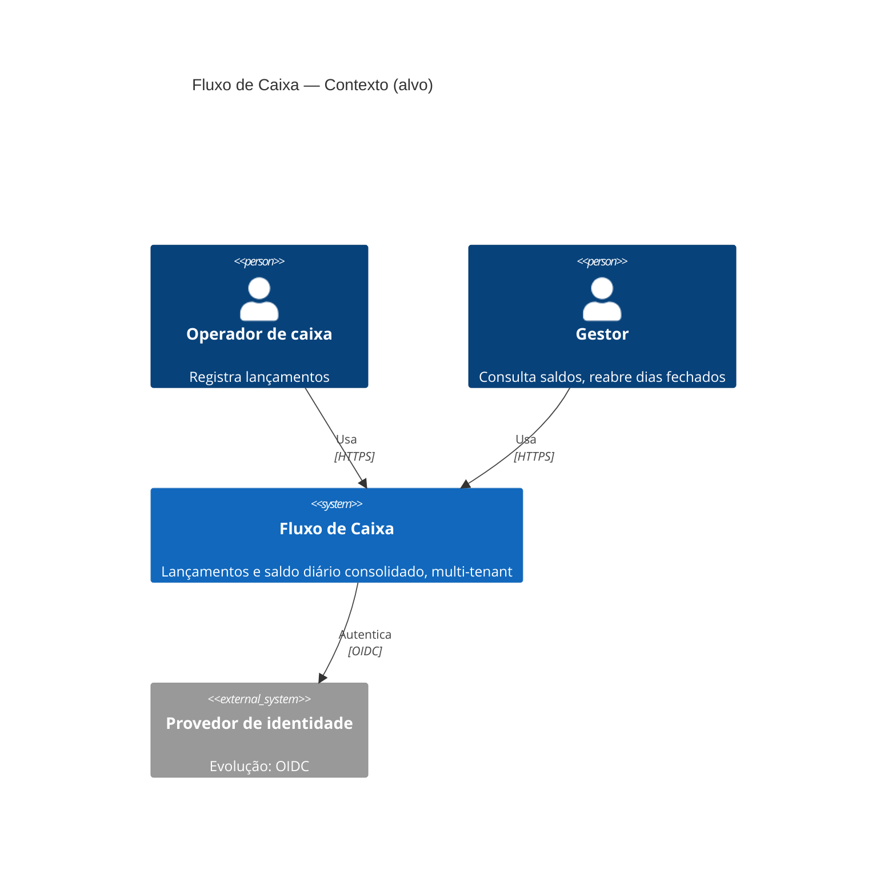
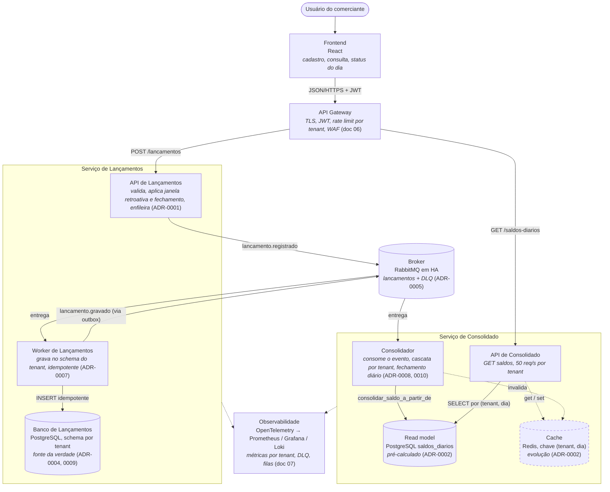
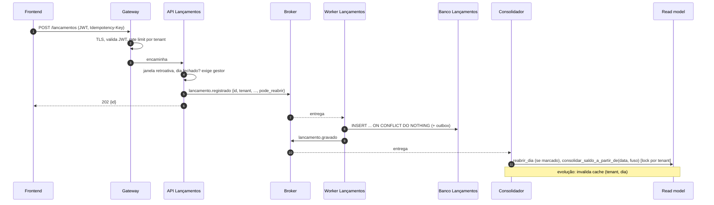
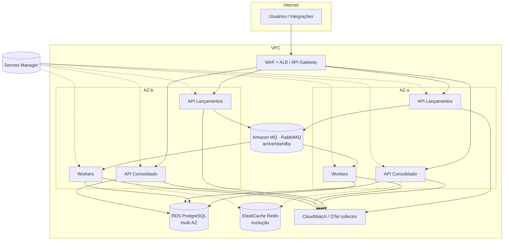

# 04 — Arquitetura alvo

Dois serviços com deploy independente, **Lançamentos** e **Consolidado**,
que se comunicam só pelo evento `lancamento.registrado` (ADR-0003). O
desenho responde a três exigências: lançamentos nunca param (RNF-01), a
leitura domina e é servida por um read model (P2, P4, ADR-0002), e os
comerciantes são isolados nos dados e na API (P1, ADR-0009). Entre a base
inicial e o pico o que muda é réplica e tamanho de instância, não o desenho.
O código deste repositório é a mesma arquitetura em um único deploy.

## C4 — Nível 1: Contexto

## C4 — Nível 2: Containers

**Dois eventos, não um.** No código de hoje o mesmo worker grava e consolida
na mesma transação. Ao separar os serviços, Lançamentos publica
`lancamento.gravado` depois do commit (via outbox) e o Consolidado consome
esse evento. A fonte da verdade continua sendo o banco de lançamentos e o
read model é reconstruível a partir dele.

## Fluxo de um lançamento (alvo)

## Topologia de deploy (AWS)

Serviços em ECS Fargate com autoscaling (por CPU; workers pela profundidade
da fila). Cenários de dimensionamento no doc 08.

## Atendimento aos RNFs

| RNF | Como a arquitetura alvo atende | Evidência |
|---|---|---|
| RNF-01 lançamentos independem do consolidado | Serviços e deploys separados; escrita depende só do broker (ADR-0001, ADR-0003) | Teste de caos (doc 09) |
| RNF-02 50 req/s por tenant, ≤ 5% perda | Read model por chave (ADR-0002); API de consolidado escala horizontalmente | k6 1 tenant: 0% falha, p95 4,7 ms (doc 09) |
| RNF-02b vários tenants em pico sem degradar os outros | Rate limit por tenant no gateway; schema/role por tenant; lock de consolidação por tenant | k6 20 × 50 req/s: 0% falha (doc 09) |
| RNF-03 nenhum 202 se perde | Fila persistente, ack manual, idempotência, DLQ (ADR-0007) | Testes unitários do worker; conferência fila + DLQ + banco |
| RNF-04 atraso de consolidação | Consolidação por evento; segundos (ADR-0002) | Métrica fila→ack (doc 07) |
| RNF-05 segurança | Gateway (TLS, JWT, WAF), perfis, role por tenant no banco (doc 06) | Testes de autorização |
| RNF-06 escalabilidade | Fargate autoscaling; workers escalam por fila; leitura por réplica/cache | — |
| RNF-07 observabilidade | OTel em todos os containers; métricas por tenant; alertas de DLQ e fila | doc 07 |
| RNF-08 recuperação | RPO/RTO definidos pelo SLA do banco gerenciado (RDS multi-AZ: replicação síncrona e backup contínuo com point-in-time). A fila persistente segura os lançamentos aceitos durante um failover, e o read model é reconstruível a partir dos lançamentos; por isso a escrita de lançamentos tem RTO efetivo próximo de zero | SLA do provedor; teste de restore documentado (evolução) |

## Falhas e escala

| Situação | O que acontece | Como escala |
|---|---|---|
| Banco de lançamentos fora | API continua aceitando (202); workers fazem requeue; fila drena ao voltar, nada se perde | — |
| Broker fora | `POST` responde 503 e o cliente repete com a mesma `Idempotency-Key`; consultas seguem; reconexão automática | Broker em HA |
| Consolidador fora | Lançamentos continuam gravados; saldos ficam defasados até consumir o backlog | Mais workers, pela profundidade da fila |
| Read model corrompido | Reconstruído a partir dos lançamentos (`reprocessar`) | — |
| Uma AZ fora | Réplicas na outra AZ; failover do RDS multi-AZ | — |
| Pico de leitura | Read model por chave; réplica de leitura; cache como evolução (ADR-0002) | API de consolidado por CPU |
| Pico de escrita | Fila absorve; consolidação serializada por tenant (ADR-0008) | Workers pela fila; incremental como evolução |
| Crescimento de comerciantes | Schema por tenant; banco dedicado por sinal (ADR-0009) | Particionamento mensal de lançamentos |

Timeouts e retry com backoff em todas as chamadas de saída.

## Integração

- **Protocolos:** HTTPS/JSON para clientes, com OpenAPI versionado por path
  (`/v1`); AMQP entre serviços.
- **Eventos:** `lancamento.registrado` (API → worker) e `lancamento.gravado`
  (worker → consolidador), JSON com `schema_version`, `id`, `comerciante_id`,
  `criado_em`, `pode_reabrir`, `usuario_id`.
- **Versionamento:** mudanças compatíveis adicionam campos; incompatíveis
  criam `v2` com período de convivência.

## Evoluções futuras

- Cache do consolidado (ADR-0002) e consolidação incremental (ADR-0008),
  quando os sinais aparecerem.
- Banco dedicado por comerciante ou por grupo (ADR-0009).
- Provedor de identidade externo e autorização por permissão (ADR-0010).
- Backoff e limite de tentativas antes da DLQ, com ferramenta de
  reprocessamento (ADR-0007).
