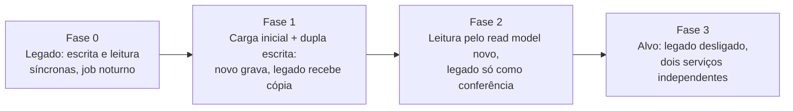

# 05 — Arquitetura de transição

## Cenário de legado assumido

Comerciantes que hoje controlam o caixa em um **sistema monolítico de
balcão** (ou planilha): lançamentos gravados de forma síncrona num banco
único, saldo diário calculado por um job noturno, sem multi-tenant (uma
instalação por loja), sem API. O dado que importa preservar é o histórico
de lançamentos; o saldo é derivável.

## Estratégia

**Strangler fig com o evento como costura.** Não migramos tudo de uma vez:
colocamos a nova API na frente, passamos a escrita para ela primeiro (é o
caminho que mais se beneficia, RNF-01), mantemos o legado lendo até o read
model novo estar validado, e só então desligamos o job noturno. Em cada
fase existe um critério objetivo para avançar e um caminho de volta.

## Fases

| Fase | O que muda | O que continua no legado | Critério para avançar | Rollback |
|---|---|---|---|---|
| 0 | Situação atual | Tudo | — | — |
| 1 | Provisiona o tenant (`criar_tenant`); **carga inicial** dos lançamentos históricos via `POST /lancamentos` com `Idempotency-Key` derivada do id legado (repetível sem duplicar), convertendo a data local do legado com o fuso do tenant; reconsolidação; frontend passa a gravar em `POST /lancamentos`; um consumidor adicional do evento `lancamento.gravado` **replica no legado** (dupla escrita via evento, não via aplicação) | Leitura de saldos e relatórios; job noturno | 30 dias com saldos diários iguais nos dois sistemas (conciliação automática, diferença zero) | Apontar a escrita de volta para o legado; o novo já tem os dados, nada se perde |
| 2 | Leitura passa para `GET /saldos-diarios`; fechamento diário do novo vira o oficial; job noturno do legado passa a ser só conferência | Legado recebe cópia dos lançamentos, mas ninguém lê dele | 30 dias sem divergência e sem abertura de chamado por saldo | Voltar a ler do legado (continua atualizado pela cópia) |
| 3 | Desliga o consumidor de cópia e o legado; separa os serviços em deploys independentes (ADR-0003) | Nada | Legado arquivado (dump) por prazo legal | Não há: a partir daqui o legado é histórico |

## Riscos da transição

| Risco | Impacto | Mitigação |
|---|---|---|
| Divergência de saldo entre legado e novo durante a convivência | Perda de confiança do comerciante | Conciliação diária automática, fase só avança com diferença zero |
| Lançamento gravado no novo e não replicado no legado (consumidor de cópia falha) | Legado defasado na fase 1 | Consumidor idempotente com DLQ; conciliação detecta; reprocessa |
| Diferença de "dia" por fuso na carga inicial | Saldos deslocados em um dia | Regra de conversão explícita, amostragem manual antes da carga completa |
| Usuários continuam usando o legado por hábito | Dados só no legado | Fase 1 bloqueia escrita no legado (somente leitura) após o corte |
| Reabertura de dia fechado não existe no legado | Regras divergentes na convivência | Reabertura só no novo; legado recebe o lançamento como ajuste |
